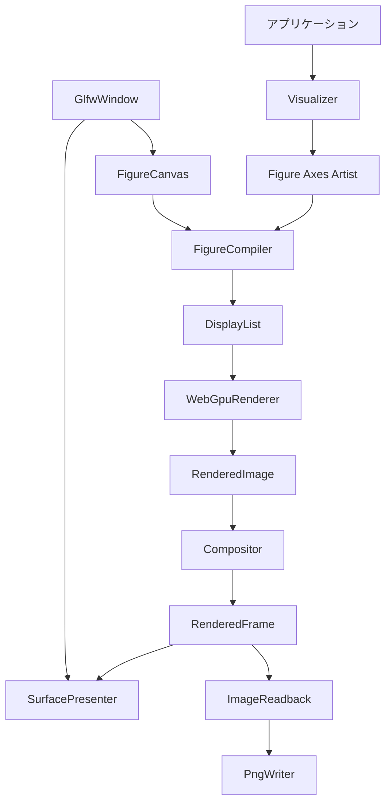

# Rust 描画バックエンド実装仕様書

版: 0.1 Draft  
作成日: 2026年10月28日  
対象: このリポジトリの2Dシミュレーション表示と画像出力

## 1 目的と実装範囲

地図、経路、ロボット、LiDAR点群、走行軌跡を描くRust製ライブラリを実装する。グラフの構成、レイアウトと座標変換、ラスタライズ、画像合成、ウィンドウ管理、出力を分離する。画面表示とPNG保存は同じ描画経路を使用する。

本仕様の「pure Rust」は、自作するライブラリ、図形処理、GPUバックエンド、FFIラッパー、シミュレーション用アダプターをRustで記述することを意味する。GPU処理にはRustの `wgpu`、シェーダーにはWGSL、ウィンドウ管理にはGLFWを使用する。GPU実行時にはOSのGPU APIローダーとドライバー、ウィンドウ表示時にはGLFWのC実装が必要である。

Rustから `wgpu` の安全なAPIを使用する。手書きのGPU用C/C++中継コードは使用しない。汎用WebGPU実装、Vulkan・Metal等の実装、WGSLコンパイラーは自作しない。`wgpu` はWebGPUに沿ったRust APIとネイティブGPUバックエンドを提供する。[wgpuの公式説明](https://docs.rs/wgpu/latest/wgpu/)

本仕様は描画ライブラリとRust側のVisualizerを対象とする。現在C++で記述されている計画・制御・自己位置推定・物理計算のRust移植は含まない。既存C++実行ファイルとの接続は `ad-visualization-ffi` のC ABIとC++側のVisualizerアダプターを通す。Rust API自体をC++のABIとして公開しない。

### 1.1 必須機能

| 要件ID | 内容 |
| --- | --- |
| FR01 | Figure内に複数のAxesを明示的な領域指定で配置できる |
| FR02 | グリッド地図を画像として描画できる |
| FR03 | 経路、軌跡、輪郭、方向線を実線または破線で描画できる |
| FR04 | 円形マーカーと点群を描画できる |
| FR05 | 線形の座標軸、矩形クリップ、縦横比維持、座標の逆変換を扱える |
| FR06 | 数値目盛り、軸枠、英数字のタイトル・軸ラベルを描画できる |
| FR07 | 描画済み画像を配置、拡大縮小、透明度指定して合成できる |
| FR08 | GLFWウィンドウへ表示し、リサイズ、最小化、再表示、終了を処理できる |
| FR09 | ウィンドウの初期化なしにPNGを保存できる |
| FR10 | Artistのデータ更新、削除、可視性変更、描画順変更ができる |
| FR11 | GPU、ウィンドウ、入出力の失敗をRustのResultで返せる |
| FR12 | 新規Rust描画処理の実行にPython、NumPy、Matplotlibを必要としない |

### 1.2 初期版の対象外

対数軸、3D、任意の曲線パス、任意形状によるクリップ、汎用ポリゴン塗りつぶし、SVG・PDF・動画出力、凡例の自動配置、レイアウトの自動最適化、ズーム等の操作UI、複雑な文字組み、日本語フォントの自動選択は対象外とする。Matplotlibとは責務分離と必要な表示機能を共有し、全API互換やピクセル単位の一致は要求しない。

初期の動作保証環境はLinux x86_64、X11、`wgpu` のVulkanバックエンドとする。WSLおよびコンテナは、ホスト側のGPU・表示接続が利用できる構成で確認する。Wayland、Windows、macOS、Wasmは後続の対応とする。ウィンドウなしの出力にも、利用可能なVulkanアダプターが必要である。

## 2 全体構成と依存方向

MatplotlibのFigure・Artist、Renderer、Canvasの責務分離を参考にする。RendererとCanvasの区別については[Matplotlibのバックエンド説明](https://matplotlib.org/stable/users/explain/figure/backends.html)を参照する。以下の具体的な型・契約は本実装の仕様である。



| 層 | 入力 | 出力と責務 | 許可する外部依存 |
| --- | --- | --- | --- |
| グラフ構成 | データと表示設定 | Figure、Axes、Artistの保持 | Rustのデータ構造 |
| レイアウトと変換 | Figure、RenderSpec | LayoutSnapshot、DisplayList | Rustの数値処理、文字計測 |
| ラスタライズ | DisplayList | オフスクリーンのRenderedImage | wgpu、WGSL |
| 画像合成 | ImageLayer列 | RenderedFrame | wgpu、WGSL |
| ウィンドウ管理 | WindowOptions、OSイベント | WindowMetrics、WindowEvent | GLFW |
| 表示 | RenderedFrame、サーフェス | PresentOutcome | wgpu、ネイティブハンドル |
| 画像出力 | RenderedFrame | CpuImage、PNGファイル | wgpu、Rust製PNGエンコーダー |
| 調停 | Figure、イベント、出力要求 | 描画の実行とキャッシュ更新 | 上記の公開API |

グラフ構成・変換層はwgpu、GLFW、シミュレーションの型を参照してはならない。RendererはFigureやロボットの意味を解釈しない。Compositorは図形を組み立てない。GlfwWindowはGPUデバイスを作成しない。PngWriterはGPU・ウィンドウを参照しない。

各層の分離はモジュールとデータ契約で行う。初期版では各型に対応する具象実装を用意し、バックエンド切り替え専用のtrait階層は必須としない。

初期化はInstance作成、必要ならウィンドウとSurface作成、互換Adapter選択、Device・Queue作成の順に行う。表示用と保存専用のCanvas生成関数を分け、利用側に未初期化のCanvasを渡さない。wgpuのリソースハンドルを上位の公開APIに要求しない。

### 2.1 Rustワークスペース

既存C++のルートCMake構成と分離し、以下の配置を用いる。

```text
rendering/
  Cargo.toml                  # workspace
  Cargo.lock
  rust-toolchain.toml
  crates/
    ad-render/
      src/
        model/                # Figure、Axes、Artist、ID
        transform/            # 単位、行列、順逆変換
        compile/              # レイアウト、DisplayList
        text/                 # フォント計測、文字配置
        gpu/                  # wgpu、リソース、実行
        raster/               # 図形展開、描画パイプライン
        compose/              # 画像合成
        window/               # GLFWとイベント
        surface/              # GLFWとwgpuの接続、表示
        output/               # 読み戻し、PNG
        canvas/               # 更新処理の調停
      shaders/
      tests/
      examples/
    ad-visualization/         # 地図、ロボット、LiDAR用のRust API
    ad-visualization-ffi/     # 既存C++呼び出し用のC ABI
```

`ad-render` の既定featureは空とする。`wgpu` がGPU処理、`window` が `wgpu` とGLFW連携、`png` がPNGエンコードを有効にする。PNGエンコード自体はCpuImageだけでも使用できる。`ad-visualization` は同じfeatureを明示的に転送する。

CPUのみのモデル・変換テストではwgpu、GLFW、C/C++コンパイラー、GPUドライバーを要求しない。ウィンドウなしのGPU出力では `wgpu,png` を使い、GLFWへのリンクも行わない。

## 3 データ型と所有権

### 3.1 基本型

| 型 | 定義と制約 |
| --- | --- |
| Point2、DataRect | データ座標のf64値。NaN、無限大は受け付けない |
| NormalizedRect | 左下原点の正規化領域。幅・高さは正、Figure内に収める |
| PixelRect | 左上原点の出力領域。計算中はf64、GPU投入時はf32へ変換 |
| PixelSize | 幅・高さが正のu32。積のオーバーフローとGPU制限を検証 |
| Points、PointsSquared | 線幅等のptと、マーカーサイズのpt²を区別する新しい型 |
| SrgbColor | 有限な0〜1のsRGB値と線形のアルファ値 |
| RenderSpec | PixelSize、正で有限なdpi、任意の背景色上書き、アンチエイリアス設定 |
| ImageData | 非ゼロの画像寸法、Arcで保持する不変のRGBA8画素。sRGB・非乗算アルファ |
| ArtistId、AxesId | 所有Figure識別子、スロット、世代番号を含む不透明な型 |

画像バッファは上から下への行優先とする。地図の行方向は画像変換時に正規化する。ImageData生成時に `width * height * 4` と実際の長さをchecked演算で検証する。

FigureがAxesを所有し、AxesがArtistを所有する。Artistは `enum` で種類を区別し、頂点列は `Arc<[Point2]>` 等の不変データを所有する。公開APIが借用スライスを受け付ける場合は呼び出し中にコピーする。入力した一時データの寿命を呼び出し元へ要求しない。

削除したID、異なるFigureのID、種類が一致しないIDによる操作はエラーとする。スロットを再利用しても古いIDは有効にならない。各変更は検証成功後に反映し、失敗時にモデルを部分更新しない。モデルの直接可変参照は公開せず、変更番号の更新を経由するAPIだけで変更する。

### 3.2 GPU画像と実行コンテキスト

RenderedImageとRenderedFrameは、wgpuテクスチャを保持する不透明な参照カウント付きハンドルとする。CPU画素を持たない。画像の所有デバイスとその世代を記録する。異なるデバイス、再初期化前のデバイスの画像を合成・表示・読み戻しに渡すとエラーにする。

公開済みの画像は内容が不変のスナップショットとする。次のフレームを描いても、保持中の以前の画像は変わらない。テクスチャを再利用できるのは、公開画像の参照がなく、GPU側の使用も終了した場合だけとする。利用側が過去のフレームを保持した分は資源予算に計上し、上限を超える要求はエラーにする。GPU画像も初期版では作成スレッド以外へ移動できない型にする。

GPU用コンテキスト、ウィンドウ、Canvasの操作は初期版では作成スレッドに限定し、Send・Syncを提供しない。画面表示を使う場合の作成スレッドはOSのメインスレッドとする。モデル・DisplayList・CpuImageはGPUハンドルを含まず、Send・Syncにできる構成とする。

## 4 グラフ構成API

以下は公開APIの契約を表す署名である。補助型のフィールドと通常のgetterは省略する。各メソッドは本節以降の検証・更新規則に従う。

```rust
impl Figure {
    pub fn new(options: FigureOptions) -> Result<Self, RenderError>;
    pub fn add_axes(&mut self, options: AxesOptions) -> Result<AxesId, RenderError>;
    pub fn remove_axes(&mut self, axes: AxesId) -> Result<(), RenderError>;
    pub fn set_limits(&mut self, axes: AxesId, limits: DataRect) -> Result<(), RenderError>;
    pub fn set_aspect(&mut self, axes: AxesId, aspect: Aspect) -> Result<(), RenderError>;
    pub fn set_axis_decoration(&mut self, axes: AxesId, value: AxisDecoration)
        -> Result<(), RenderError>;

    pub fn imshow(&mut self, axes: AxesId, image: Arc<ImageData>, options: ImageOptions)
        -> Result<ImageId, RenderError>;
    pub fn plot(&mut self, axes: AxesId, points: Arc<[Point2]>, style: LineStyle)
        -> Result<LineId, RenderError>;
    pub fn scatter(&mut self, axes: AxesId, points: Arc<[Point2]>, style: MarkerStyle)
        -> Result<MarkerId, RenderError>;
    pub fn text(&mut self, axes: AxesId, text: TextSpec) -> Result<TextId, RenderError>;

    pub fn set_line_data(&mut self, id: LineId, points: Arc<[Point2]>)
        -> Result<(), RenderError>;
    pub fn set_marker_data(&mut self, id: MarkerId, points: Arc<[Point2]>)
        -> Result<(), RenderError>;
    pub fn set_image(&mut self, id: ImageId, image: Arc<ImageData>)
        -> Result<(), RenderError>;
    pub fn set_style(&mut self, id: ArtistId, style: ArtistStyle) -> Result<(), RenderError>;
    pub fn set_visible(&mut self, id: ArtistId, visible: bool) -> Result<(), RenderError>;
    pub fn set_z_order(&mut self, id: ArtistId, order: i32) -> Result<(), RenderError>;
    pub fn remove_artist(&mut self, id: ArtistId) -> Result<(), RenderError>;
    pub fn clear_artists(&mut self, axes: AxesId) -> Result<(), RenderError>;
}
```

FigureOptionsは背景色を持つ。出力寸法とDPIはモデルに固定せずRenderSpecで与える。AxesOptionsは正規化配置、データ範囲、Aspect、背景色、軸装飾を持つ。軸は線形、データ範囲は `xmin < xmax`、`ymin < ymax` に限定する。

Artistはデータ座標・Axes座標・Figure座標のいずれかを指定する。画像と折れ線は初期版ではデータ座標、マーカーの中心はデータ座標、文字は3種類をサポートする。マーカーや線の幅は中心・頂点の座標系とは独立した表示単位である。

空の点列は正常な非表示データとして受け付ける。折れ線が1点の場合は線を描かない。同一座標が連続する線分は展開前に除去する。閉じた線は最終点と先頭点を接続する。可視性がfalseのArtistはレイアウトと描画命令生成から除外する。

Axesは追加順に、それぞれ背景、Artist、軸装飾の順で描画する。Axes内のArtistは `(z_order, 追加順)` で安定ソートする。標準z_orderは画像0、折れ線10、マーカー20、文字30とする。後に追加したAxes全体が先のAxesに重なる。

## 5 座標変換とレイアウト

### 5.1 座標系

| 座標系 | 原点と方向 | 用途 |
| --- | --- | --- |
| データ | 左下原点、X右、Y上 | 地図・経路はメートル |
| Axes | 左下が0,0、右上が1,1 | 最終的なプロット領域内の配置 |
| Figure | 左下が0,0、右上が1,1 | Axesの配置 |
| 出力 | 左上原点、X右、Y下 | 物理ピクセル |
| GPUクリップ | XとYが-1〜1 | Renderer内部だけで使用 |

座標変換はf64で行い、出力付近の座標へ変換してからGPU用f32へ変換する。表示範囲外の巨大な有限値も、オーバーフローや不正な頂点を生成しないようCPU側で安全に除外・処理する。

プロット矩形の左上を `(L,T)`、幅・高さを `(W,H)` とすると、データ座標は以下で出力座標へ変換する。

```text
x_px = L + (x - xmin) / (xmax - xmin) * W
y_px = T + (ymax - y) / (ymax - ymin) * H
```

Aspect::Autoは矩形全体を使用する。Aspect::Equalは単位当たりの倍率を `min(W / Δx, H / Δy)` に揃え、データ範囲を変更せずプロット矩形を中央へ縮小する。軸の逆転、非線形変換は対象外とする。

LayoutSnapshotはRenderSpecとFigureの変更番号、各Axesの最終矩形、順変換・逆変換を保持する。プロット外のクリックは `None`、特異な変換はエラーとする。逆変換は最後にコンパイルしたレイアウトに対するものとし、入力処理は表示済みフレームと対応するSnapshotを使う。

出力ピクセルの中心は `i + 0.5, j + 0.5`、画像とプロット矩形の範囲は画素の外縁で定義する。これにより地図セル中心と経路座標の半セルずれを防ぐ。

### 5.2 DPIと表示単位

線幅、破線間隔、文字サイズはpt、マーカーサイズはpt²とする。Compilerで `px = pt * dpi / 72`、マーカーの基準長を `sqrt(area_pt2) * dpi / 72` に変換する。円形マーカーはこの基準長を直径とし、円の厳密な幾何学面積をarea_pt2と解釈しない。初期版のマーカー輪郭線はなしとする。[Matplotlibのscatter](https://matplotlib.org/stable/api/_as_gen/matplotlib.pyplot.scatter.html)もサイズをpt²で定義している。

RenderSpecの標準値は800×600ピクセル、dpiは100、背景色上書きはなしとする。FigureOptionsの背景色は標準で不透明な白とし、上書きを指定した場合だけRenderSpecを優先する。画面表示では標準論理DPI100にGLFWのcontent scaleを適用する。入力座標のピクセル変換にはフレームバッファ寸法とウィンドウ寸法の比を使い、content scaleをさらに重ねて乗算しない。非等方のcontent scaleでは大きい側を表示サイズの倍率とする。

### 5.3 軸装飾とクリップ

AxisDecorationは表示有無、タイトル、X・Yラベル、目盛りの値と表示文字列を持つ。必須の目盛り方式は `None` と `Fixed` とする。自動目盛り計算は拡張とする。

AxesOptionsの領域は装飾を含む外側の領域とする。装飾を表示する場合、左48pt、右12pt、上24pt、下40ptを初期の余白とし、その内側へプロット矩形を置く。余白は設定可能とする。文字による余白の自動拡張は行わない。余白を引いて領域がなくなる場合はLayoutTooSmallを返す。

データ図形は最終プロット矩形でクリップする。目盛り文字・タイトルはFigure内でクリップし、プロット矩形では切らない。整数scissorを広めに設定するだけで小数位置の境界から漏れる場合は、シェーダー側でも境界を判定する。

## 6 DisplayListとコンパイル

```rust
pub struct CompiledFigure {
    pub display_list: DisplayList,
    pub layout: LayoutSnapshot,
}

impl FigureCompiler {
    pub fn compile(&mut self, figure: &Figure, spec: &RenderSpec)
        -> Result<CompiledFigure, RenderError>;
}
```

DisplayListはCPUだけで解釈できる不変のスナップショットであり、GPUハンドルを含まない。Artistの座標系、単位、描画順を解決した次の命令を保持する。

| 命令 | 内容 |
| --- | --- |
| FillRect | 背景や軸枠の矩形と色 |
| DrawImage | 画像参照、出力矩形、UV、補間方法、クリップ |
| StrokePath | 出力座標の頂点列、線幅、破線、接続・終端、クリップ |
| DrawMarkers | 出力座標の中心列、直径、色、クリップ |
| DrawGlyphs | フォント識別子、字形、配置、サイズ、色、クリップ |

フォントデータを含む参照資源もスナップショットが寿命を保持する。画像・フォント・字形資源の識別子は、更新内容を区別できるものとする。単なるメモリアドレスだけをキャッシュキーにしない。

CompilerはArtistと軸装飾の意味を描画命令に変換する。線の三角形化、字形アトラスへのアップロード、GPUバッファの生成はRenderer側の責務とする。CPU上の文字計測とGPU描画は、同じフォント・サイズ・字形メトリクスを使用する。

## 7 ラスタライズ

```rust
impl WebGpuRenderer {
    pub fn render(&mut self, compiled: &CompiledFigure)
        -> Result<RenderedImage, RenderError>;
}
```

Rendererは常にオフスクリーンのテクスチャへ描画する。ウィンドウのサーフェスへ直接Figureを描かない。描画済み画像と、それを生成したRenderSpec・変更番号の対応を保持する。

### 7.1 図形ごとの動作

- 画像は四角形へ貼る。NearestとLinearをサポートし、地図ではNearestを使用する。
- 線はRust側で三角形へ展開する。終端はButt・Round、接続はBevel・Roundをサポートし、既定はRoundとする。曲面の近似誤差は出力座標で0.25ピクセル以下とする。
- 同一の折れ線の隣接線分・接続部が重なることだけを理由に、半透明色が二重に濃くならないようにする。別Artist同士の重なりは通常の合成とする。
- 破線は線全体の出力座標上の累積長で位相を進める。頂点やクリップ境界ごとに位相をリセットしない。閉じた線では閉路の接続部でパターンが一致することまでは保証しない。
- DashPatternは正で有限な偶数個の長さと有限なオフセットを持つ。初期の破線既定値は6pt描画・4pt空白とする。
- 円形マーカーはインスタンス描画し、ズームしても表示直径を維持する。
- 初期版のアンチエイリアスは1サンプルと4サンプルMSAAを選択可能とし、標準は4とする。合成へ渡す画像はresolve済みとする。

### 7.2 文字

文字計測と字形のラスタライズにはRust製のフォントライブラリを使用できる。初期候補はfontdueとする。fontdueは字形メトリクスとカバレッジ画像を返すAPIを持つ。[fontdueのAPI](https://docs.rs/fontdue/latest/fontdue/struct.Font.html)

試験用のフォントをライセンス表記とともに固定して同梱する。ASCIIの印字可能文字を必須とする。その他の文字は固定フォントに字形がある場合に描画し、ない場合は置換字形を表示する。フォントフォールバック、双方向文字、合字処理は行わない。

文字の配置は左・中央・右、およびベースライン・上・中央・下を指定可能とする。軸ラベル用に0度と90度の回転を扱う。字形キャッシュはフォント、字形、出力サイズをキーとし、DPIが変わった場合に古いサイズを流用しない。

## 8 画像合成と色

ImageLayerはRenderedImage、配置先PixelRect、UV範囲、透明度、NearestまたはLinearの補間を持つ。回転・任意の射影変換は初期版では扱わない。

FrameSpecは正のPixelSizeと背景色を持ち、背景の標準は透明とする。レイヤーの配置寸法は正で有限、UVは0〜1、透明度は0〜1で有限とする。配置がフレーム外へ出た場合は切り取り、完全に外側ならスキップする。レイヤーが空の場合は背景だけのフレームを返す。

```rust
impl Compositor {
    pub fn compose(&mut self, layers: &[ImageLayer], spec: &FrameSpec)
        -> Result<RenderedFrame, RenderError>;
}
```

レイヤーは配列の先頭から背面→前面の順に合成する。画像は同じデバイスに属する必要がある。初期のFigureCanvasはFigure画像1枚をレイヤーとして渡す。複数のFigure画像を扱うアプリケーションはCompositorを直接利用できる。

内部画像は線形RGB・乗算済みアルファ、形式はRgba8Unormを基準とする。入力画像と色指定のsRGBを線形へ変換してから描画し、アルファにはガンマ変換をかけない。合成はsource-overとし、色は `src + dst * (1 - src_alpha)` で計算する。レイヤーの透明度は乗算済みRGBとアルファの両方に適用する。

画面出力では不透明な背景色の上へ合成し、サーフェスは不透明モードを使用する。sRGBサーフェス形式では書き込み時の変換を使用し、非sRGB形式ではPresenterのシェーダーが変換する。同じ変換を二重適用しない。内部Rgba8Unormでの量子化を含むため、高精度な科学画像出力は対象外とする。

## 9 wgpuとの接続と安全性

### 9.1 バージョンとGPU資源

`wgpu` の検証済みバージョンをCargo.tomlとCargo.lockで固定する。GPU実行では初期版はVulkanバックエンドを選ぶ。GPUドライバーおよびVulkanローダーは実行環境が提供する。

GpuContextはInstance、Adapter、Device、Queueと進行中の処理を所有する。画面表示では対応するサーフェスを作成してから互換アダプターを選ぶ。保存専用ではサーフェスなしでアダプターを選ぶ。保存専用で作ったデバイスに後から任意のウィンドウを接続できるとは保証しない。

使用するGPUリソースはWebGPU標準のバッファ、テクスチャ、サンプラー、シェーダー、レンダーパイプライン、コマンドエンコーダーを基本とする。wgpu固有の制御はgpuモジュールへ隔離し、DisplayListと上位APIへ露出させない。

### 9.2 unsafeの境界

自作のunsafeはネイティブサーフェス接続、明示的なバイト列変換、アプリケーション間C ABIのポインター変換に限定する。C ABIのunsafeは `ad-visualization-ffi` に隔離する。モデル、座標変換、Visualizer、PNGエンコードにunsafeを導入しない。

各unsafe箇所は、ハンドルの有効性、メモリ範囲、アラインメント、所有権、スレッド、コールバックの寿命を説明する。GPU資源はwgpuの所有型で管理する。mapped bufferの参照はコピー中だけ借用し、unmap後に残さない。WGSLとの共有構造体はrepr(C)、明示的なパディング、サイズ・オフセット検査を用い、Rustの通常の構造体配置を仮定しない。

### 9.3 非同期処理とエラー

Adapter・Device要求、読み戻しにはwgpuの非同期APIを使用する。同期公開APIは内部でイベント進行と短い待機を行い、期限を超えたらTimeoutを返す。無制限のビジーループは禁止する。GPU検証エラーとデバイス喪失は診断を保持し、関連する公開APIからResultで返す。

コールバックはスレッド安全な通知キューだけへ書き込み、FigureやGLFWを直接操作しない。RustのpanicをC ABIの外へ伝播させない。コールバック内の処理は短く保つ。

明示的なshutdownで進行中処理を終了させ、その後でリソースを解放する。Dropはpanicせず、デバイス喪失後は新規描画を拒否する。自動でデバイスを再構築する機能は初期版では設けない。

## 10 ウィンドウ管理と表示

GlfwRuntime、GlfwWindowはRustのglfwクレートを介してGLFWを使用し、GLFW_NO_APIでウィンドウを作る。OpenGLコンテキストの作成やswap_buffersは行わない。初期化・ウィンドウ操作・イベント処理はメインスレッドで行う。[GLFWのスレッド制約](https://www.glfw.org/docs/latest/intro_guide.html#thread_safety)、[Rustのglfw API](https://docs.rs/glfw/latest/glfw/)

GlfwWindowは次の情報を公開する。

- WindowMetrics: 論理ウィンドウ寸法、フレームバッファ寸法、content scale。
- WindowEvent: close、resize、scale変更、refresh、キー、ポインター、スクロール。
- ウィンドウを保持したまま、内部接続層だけが利用できるネイティブハンドル。

raw-window-handle等の借用ハンドルを利用し、ウィンドウの生存期間よりサーフェスが長生きしない構造にする。初期の接続実装はX11に限定する。公開APIへX11の型を露出させない。

SurfacePresenterはサーフェスのcapabilitiesを確認し、対応形式とFIFO表示モードを選択する。フレームバッファが0×0なら取得・再設定・表示をスキップする。resizeとscale変更時は同じ寸法での不要な再設定を避け、Canvas側のレイアウトも更新する。

サーフェステクスチャ取得の正常・劣化成功・再設定必要・タイムアウト・致命的失敗を、固定したヘッダーの状態値に対応付ける。再設定が必要な場合は1回だけ再設定して再試行する。繰り返す場合はそのフレームをスキップし、ビジーループしない。

```rust
pub enum PresentOutcome {
    Presented,
    Skipped(SkipReason),
}

impl SurfacePresenter {
    pub fn present(&mut self, frame: &RenderedFrame)
        -> Result<PresentOutcome, RenderError>;
}
```

取得したサーフェステクスチャはフレーム内で使用・提示・解放し、次のフレームへ持ち越さない。サーフェス、ウィンドウ、GLFWランタイムの順に終了する構造にする。

## 11 画像の読み戻しとPNG保存

```rust
impl ImageReadback {
    pub fn read(&mut self, frame: &RenderedFrame, options: &ReadbackOptions)
        -> Result<CpuImage, RenderError>;
}

impl PngWriter {
    pub fn write(&self, image: &CpuImage, path: &std::path::Path)
        -> Result<(), RenderError>;
}
```

読み戻しは表示先のサーフェスではなくRenderedFrameを対象にする。copy用バッファではRGBA8の1行を256バイト境界へ切り上げ、checked演算で確保サイズを計算する。GPUの完了とmap成功を確認してからCPUへコピーし、各行のパディングを除去する。画像幅が64の倍数ではないケースも扱う。

CpuImageは上から下の行優先、RGBA8、sRGB、非乗算アルファとする。内部の線形・乗算済み画素から、アルファ除算→sRGB変換→8bit化の順に変換する。アルファ0のRGBは0にする。透過保存と不透明背景での保存をサポートする。

PNGにsRGB情報を付与する。ファイル保存はウィンドウを閉じず、Figureを変更しない。親ディレクトリの作成は呼び出し側の責務とする。既存ファイルの置換は同一ディレクトリの一時ファイルへの書き込み成功後に行い、失敗時には既存ファイルを維持する。

save_pngはpresentの先行呼び出しを要求しない。表示後にFigureが更新された場合も、保存時点の状態をコンパイル・描画する。画面とは別のRenderSpecで保存でき、保存用レイアウトによって表示用のLayoutSnapshotを上書きしない。UIやウィンドウ装飾のスクリーンショットは保存範囲に含めない。

透過保存ではFigureの背景色上書きとFrameSpecの背景を透明にする。Axesの背景は独立したモデル設定なので、そこも透過させる場合は明示的に変更する。保存機能がArtistやAxesの不透明色を自動的に透明へ置き換えることはない。

## 12 FigureCanvasと更新処理

FigureCanvasはFigure、Compiler、描画・合成処理、キャッシュを調停する。表示用のオプションと保存用のオプションは分離する。アプリケーションがメインループを所有し、Canvasは無限ループやシミュレーション時間の進行を内包しない。

| API | 動作 |
| --- | --- |
| figure、編集用メソッド | Figureの参照・変更。変更番号を必ず更新する |
| process_events | GLFWおよびwgpuの通知を進め、WindowEventを返す |
| request_redraw | 次の描画を要求する |
| draw | 最新状態をコンパイル・描画・合成してRenderedFrameを返す |
| present | 描画が必要なら実行し、表示する |
| save_png | 指定RenderSpecで最新状態をPNGへ保存する |
| last_presented_layout | 最後に提示したフレームの座標変換を返す |
| close、shutdown | 表示終了とGPU処理の終了を明示する |

静止中でもrefreshイベントで再表示できるよう、最後のフレームまたは再生成可能なモデルを保持する。イベント処理は描画周期とは独立して呼び出せる。描画後のGPU完了を毎フレームCPUで待たず、待機はフレーム数の上限に達した場合と読み戻し等に限定する。

キャッシュキーはFigureの変更番号、RenderSpec、フォント・画像の変更識別子、デバイス世代を含む。削除、色変更、DPI、軸範囲、aspect、装飾変更でも無効化する。最初はFigure全体の再コンパイル・再描画でよく、背景と動体の分割キャッシュは拡張とする。

初期のフレーム内処理上限は3フレーム、読み戻しの同時進行上限は2件とする。上限到達時は設定された期限の範囲で待機し、達しなければBusyまたはTimeoutを返す。資源キャッシュには容量上限を設け、完了前のGPU処理が参照する資源を再利用・破棄しない。メモリー不足時に無制限なキャッシュ拡張を行わない。

## 13 シミュレーション用Visualizer

ad-visualizationはRustのPose2、Point2、Footprint、LidarScan、GridMapを受け取る。GPU・ウィンドウ型をこれらのドメインデータへ埋め込まない。ロボットやLiDARの座標変換はここで行い、グラフ層以下へその意味を渡さない。

### 13.1 地図の契約

GridMapは幅、高さ、正で有限なresolution、行優先のi8グリッドを持つ。行0が下側、列0が左側とし、セルの外縁は `x*resolution`、`y*resolution`、中心は `(x+0.5)*resolution`、`(y+0.5)*resolution` とする。この定義は既存の `src/features/planning/planner_utils.cpp` のセル中心計算と整合させる。

prepare_mapはCPUだけで動作する。行を反転して上から下のImageDataに変換し、データ範囲 `[0, width*resolution] × [0, height*resolution]` を付与する。グリッドが正なら占有、0以下なら非占有として扱う既存の二値化を維持する。標準色は占有が黒、非占有が白とし、パレットを指定可能にする。

現実装はimshowのextentを明示せず、経路をセル単位へ変換している。新実装ではセルの外縁と中心を明示し、半セルずれを解消する。また地図色は明示パレットとする。これらは旧Matplotlib画像との意図した表示差であり、旧画像全体とのピクセル比較を受け入れ条件にしない。

既存MapDataに保持されていない地図原点・回転の一般化は行わない。必要になった場合はGridMapの仕様を追加する。

### 13.2 必要な操作

| Rust API | 契約 |
| --- | --- |
| prepare_map | GridMapを検証しPreparedMapを返す。GPU・GLFWは初期化しない |
| begin_frame | 地図とAxesを設定し、互換描画用の前フレームの動体Artistを消す |
| render_path | データ座標の折れ線を登録する |
| render_robot | footprintを姿勢で変換し、赤い輪郭・中心マーカー・方向線を登録する |
| render_marker | 1点の円形マーカーを登録する |
| render_points | 点群を1つのMarkerArtistとして登録する |
| render_scan | 姿勢と距離・角度からワールド点群へ変換して登録する |
| present_frame | Canvas経由で画面表示する |
| save_figure | 最新のFigureをPNG保存する。表示を前提とせず、終了も行わない |

ロボットの方向線は現在の実装と同じ長さ0.5mとする。中心マーカーは40pt²、LiDARは10pt²を既定値とする。サイズ0以下や非有限値はエラーとする。

距離が非有限、負、max_range超過のLiDAR値は欠測として除外する。すべて欠測の場合は空の点群とする。姿勢、min_angle、angle_increment、max_range自体が不正ならエラーとする。空のfootprintはエラーにする。

Rust APIのスタイルは型で指定する。既存呼び出しの移行を支援する場合はVisualizer内だけで `b-`、`r-`、`m-`、`k--`、`c--` と red、green、blue、black、cyan、magenta、lime を解釈する。未知の文字列はエラーとする。任意のMatplotlibスタイル文字列の解釈は行わない。

### 13.3 C++呼び出し境界

`ad-visualization-ffi` はバージョン付きのC ABIを `include/ad_visualization_ffi.h` で公開する。境界を越える値は固定幅のスカラー、`repr(C)` 構造体、ポインターと長さ、不透明ハンドルに限定する。RustとC++のコンテナー、例外、文字列オブジェクトを直接渡さない。入力配列は呼び出し中だけ借用し、必要なデータをRust側へコピーする。VisualizerとPreparedMapのハンドルは対応する破棄関数で解放し、C++のPreparedMapのコピーはハンドルの共有所有として扱う。

C関数はステータスコードと固定長の診断メッセージを返し、panicをABIの外へ伝播させない。C++アダプターは既存の `Result` / `Status` に変換する。ウィンドウ操作とその後のハンドル破棄は同じスレッドで行い、同一Visualizerへの同時呼び出しは行わない。ビルドにはRustツールチェーンを要し、C++の可視化部分にはPython、NumPy、Matplotlibを要しない。

## 14 エラーと診断

RenderErrorはstd::error::Errorを実装し、種類、対象操作、原因を保持する。ライブラリの通常の入力誤り・環境異常でpanicしない。代表的な種類を以下に定める。

| 種類 | 例 |
| --- | --- |
| InvalidInput、InvalidSize | 非有限座標、寸法、DPI、画像長、線幅 |
| InvalidHandle、TypeMismatch | 削除済みID、別FigureのID、Artist種別不一致 |
| LayoutTooSmall | 余白を確保すると描画領域がなくなる |
| AdapterUnavailable、DeviceCreationFailed | 使用できるGPUがない、初期化失敗 |
| Unsupported、WrongContext | サーフェス・形式非対応、別デバイスの画像 |
| ShaderCompilation、GpuValidation | WGSLやリソース使用の失敗 |
| DeviceLost、ResourceExhausted | デバイス喪失、GPUメモリー不足 |
| WindowCreation、SurfaceFailure | GLFW初期化、サーフェス作成、表示の失敗 |
| WrongThread、Closed | 作成スレッド以外の操作、終了済み操作 |
| Busy、Timeout、Readback | 上限到達、完了期限超過、map失敗 |
| Font、Io、PngEncoding | フォント読込、ファイル操作、PNG生成 |

通常の最小化や一時的な表示スキップはエラーと区別する。GPUエラーは成功扱いで握りつぶさず、関連操作か次のprocess_eventsで取得できるようにする。ログ出力先は呼び出し側が設定し、ライブラリから標準出力へ常時出力しない。

## 15 ビルドと依存管理

Rustのeditionは2024とする。実装開始時に動作確認したツールチェーンの番号をrust-toolchain.tomlへ固定する。Rust依存はCargo.tomlとCargo.lockで固定する。未検証の最新版を自動選択しない。

`wgpu` はCargo依存として取得し、初期版はVulkanバックエンドとWGSLを有効にする。通常のcargo build中に別途ネイティブ実装をネットワーク取得しない。ウィンドウ表示にはGLFWのX11ビルド用開発ライブラリ、GPU実行には対応するVulkanローダーとドライバーを要求する。

## 16 受け入れ条件

以下は実装完了時に満たす条件であり、今後作成するRustワークスペースに対する試験とする。

| 試験ID | 対象要件 | 合格条件 |
| --- | --- | --- |
| AT01 | FR01、FR05 | 複数Axes、Auto・Equal、異なる縦横比、DPI変更の順逆変換を検証。通常座標の往復誤差は `1e-9 * max(1, abs(value))` 以下 |
| AT02 | FR02 | 2×2の非対称な地図で上下・左右とセル中心の一致を確認。Nearestで境界に不要な補間色がない |
| AT03 | FR03 | 開閉線、重複点、1点・空列、実線・破線、クリップ後の破線位相が仕様どおり |
| AT04 | FR04、FR05 | ズームしても線幅とマーカー直径が一定。DPIを2倍にすると表示サイズも2倍 |
| AT05 | FR06 | 固定フォントによる目盛り、英数字、ラベル回転、配置、プロット外の装飾を確認 |
| AT06 | FR07 | 2画像の配置・縮小・透明合成を確認。既知のsource-over計算と、保存画素を線形・乗算済み表現へ戻した値の差が各成分3/255以下 |
| AT07 | FR09 | DISPLAYとWAYLAND_DISPLAYがない環境で、GLFWのリンク・初期化なしにwgpuでPNGを保存できる |
| AT08 | FR09 | 幅257、高さ13の画像を保存し、行パディング、上下方向、アルファ、色変換が正しい |
| AT09 | FR09、FR10 | 一度もpresentせず保存でき、表示後の更新も保存に反映される。保存用DPIが表示レイアウトを変更しない |
| AT10 | FR08 | resize、最小化、復帰、refresh、close、scale変更を処理し、0寸法のサーフェスを設定しない |
| AT11 | FR10 | 削除・別Figure・再利用前のIDを拒否。失敗した更新はモデルを変更しない |
| AT12 | FR11 | Adapterなし、DeviceLost、map失敗、書込不可、通知遅延を注入して、panic・ハング・解放後参照を起こさない |
| AT13 | FR12 | CPU試験はnative依存なしで実行可能。Rustサンプルの描画・保存がPython環境なしで実行可能 |
| AT14 | FR02、FR03、FR04 | 地図、計画経路、真値・推定軌跡、ロボット、LiDAR、開始・終了マーカーを含む固定シーンを表示・保存 |
| AT15 | FR07、FR11 | 異なるGPUコンテキスト・世代の画像利用を拒否し、終了時にサーフェスより先にウィンドウを破棄しない |
| AT16 | FR07、FR10 | 以前のRenderedFrameを保持して次の描画を行っても、保持した画像の内容は変わらない |

CPUのモデル・変換・FFI所有状態の試験と、実際のwgpuを使うGPU統合試験を分ける。故障注入用の内部境界は用意するが、公開APIをモック専用設計にしない。GPUがないCIでは統合試験を明示的にskipし、対応環境の統合試験をリリース条件とする。

画像比較は固定フォント・固定RenderSpecで行う。GPU間の境界ピクセル差を許容し、内部画素の色、幾何位置、クリップ、マーカー径等を個別に判定する。画面表示と保存の比較は同じRenderedFrameを対象とし、OSの色管理や装飾を含む画面キャプチャと同一とは要求しない。

負荷確認には1024×1024地図、各1万点の経路・軌跡・LiDAR、1台のロボットを用い、1000フレーム更新する。最終版と同じ資源が定常状態で再利用され、フレーム数に比例してGPU資源・キャッシュ件数が増えないことを確認する。CPUのコンパイル・図形展開時間、GPU実行時間、読み戻し時間を分けて記録する。初期版ではハードウェアに依存するFPS保証値を設定しない。

## 17 実装順序

1. モデル、単位、ID、座標変換、LayoutSnapshot、CPU試験を実装する。
2. 固定wgpuのGPU接続と安全な所有権処理を実装し、オフスクリーンの矩形・画像・線・点を描く。
3. Compositor、読み戻し、PNGを実装し、表示なしの固定シーンでAT02・AT06・AT07・AT08を通す。
4. GLFW接続、Presenter、Canvasのイベント処理を実装し、表示と保存を統合する。
5. 破線、文字、軸装飾、Rust Visualizer、更新・終了・故障系を実装する。
6. 全受け入れ条件と負荷確認を通し、依存の固定値、ビルド手順、サンプルを確定する。

各段階の描画は同じDisplayListと画像契約を使う。表示専用と保存専用の別レンダラーを増やさない。
